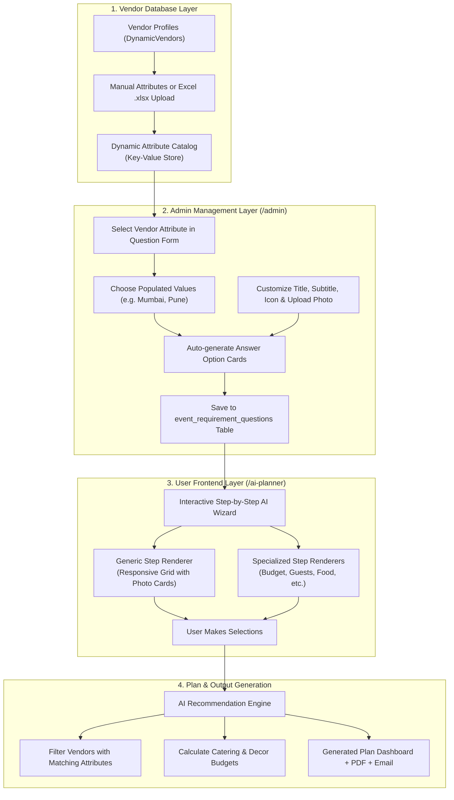

# 📘 ShadiSense — AI Planner Questions & Vendor Attributes: Complete Client User Manual

> **Document Version:** 1.0  
> **Target Audience:** System Administrators, Content Managers, Event Coordinators, and Platform Owners  
> **Platform:** ShadiSense Event Planner (Laravel Multi-Vendor AI Platform)  
> **Modules Covered:** Event Requirement Questions (`/admin/event-requirement-questions`) & Dynamic Vendors (`/admin/vendors`)

---

## 📑 Table of Contents
1. [Executive Summary & Mental Model](#1-executive-summary--mental-model)
2. [High-Level Architecture & Data Flow](#2-high-level-architecture--data-flow)
3. [Module 1: Dynamic Vendor Attributes (The Foundation)](#3-module-1-dynamic-vendor-attributes-the-foundation)
   - [What are Vendor Attributes?](#what-are-vendor-attributes)
   - [How to Add Attributes Manually to a Vendor](#how-to-add-attributes-manually-to-a-vendor)
   - [Bulk Uploading Attributes via Excel (.xlsx)](#bulk-uploading-attributes-via-excel-xlsx)
   - [Supported vs. Unsupported Attribute Types](#supported-vs-unsupported-attribute-types)
4. [Module 2: Event Requirement Questions (`/admin/event-requirement-questions`)](#4-module-2-event-requirement-questions)
   - [Understanding Question Fields](#understanding-question-fields)
   - [Question Codes: Reserved Codes vs. Custom Codes](#question-codes-reserved-codes-vs-custom-codes)
   - [Question Types (Radio, Checkbox, Number, Text)](#question-types)
   - [Step Sequencing & Display Order](#step-sequencing--display-order)
5. [Module 3: Connecting Questions to Vendor Attributes (The Smart Mapping)](#5-module-3-connecting-questions-to-vendor-attributes)
   - [Why Connect Questions to Vendor Attributes?](#why-connect-questions-to-vendor-attributes)
   - [Step-by-Step Mapping Guide](#step-by-step-mapping-guide)
   - [The "Select All" & Live Vendor Preview Tooltip](#the-select-all--live-vendor-preview-tooltip)
   - [Special Case: Catering & Food Costing (`food_type`)](#special-case-catering--food-costing-food_type)
6. [Module 4: Designing Visual Answer Option Cards](#6-module-4-designing-visual-answer-option-cards)
   - [Option Label & Option Subtitle](#option-label--option-subtitle)
   - [FontAwesome Icon Picker](#fontawesome-icon-picker)
   - [Uploading & Replacing Card Images](#uploading--replacing-card-images)
   - [Adding, Deleting & Re-arranging Option Cards](#adding-deleting--re-arranging-option-cards)
7. [Module 5: How It Appears to Users in the AI Planner (`/ai-planner`)](#7-module-5-how-it-appears-to-users-in-the-ai-planner)
   - [The Multi-Step AI Wizard](#the-multi-step-ai-wizard)
   - [Custom Renderers vs. Generic Question Renderers](#custom-renderers-vs-generic-question-renderers)
   - [How Answers Feed into Vendor Recommendation & PDF Plan Generation](#how-answers-feed-into-vendor-recommendation--pdf-plan-generation)
8. [Practical Walkthrough: Step-by-Step Tutorials](#8-practical-walkthrough-step-by-step-tutorials)
   - [Tutorial A: Creating a New Decor Style Question with Vendor Mapping](#tutorial-a-creating-a-new-decor-style-question-with-vendor-mapping)
   - [Tutorial B: Adding a Standalone Custom Question (No Vendor Mapping)](#tutorial-b-adding-a-standalone-custom-question-no-vendor-mapping)
9. [Troubleshooting & Common FAQs](#9-troubleshooting--common-faqs)
10. [Field Validation & Constraints Cheatsheet](#10-field-validation--constraints-cheatsheet)

---

## 1. Executive Summary & Mental Model

In ShadiSense, the **AI Event Planner** (`/ai-planner`) is an interactive wizard that guides couples and event hosts step-by-step through designing their wedding or celebration. 

Instead of showing static, hardcoded questions, the platform is **100% dynamic**:
- **Questions** are managed directly from the Admin Dashboard.
- **Answer Options** can be linked directly to **Vendor Attributes** (such as Mandap Themes, Photography Styles, Service Cities, Guest Capacities, or Catering items).
- When a user selects an answer option in the planner, the AI engine directly matches their choice against vendors in the database who offer that exact attribute.
- This creates personalized wedding itineraries, vendor allocations, and automated budget breakdowns.

```
┌─────────────────────────┐       ┌───────────────────────────────┐       ┌────────────────────────┐
│  1. Dynamic Vendors     │       │ 2. Admin Questions Engine     │       │ 3. User AI Planner     │
│  Vendors have dynamic   │ ────> │ Admin maps vendor attributes  │ ────> │ Users answer questions │
│  attributes (e.g. city, │       │ into user-facing questions    │       │ with visual cards,     │
│  decor, food, pricing)  │       │ with images, icons & labels   │       │ icons, and images      │
└─────────────────────────┘       └───────────────────────────────┘       └────────────────────────┘
                                                                                      │
                                                                                      ▼
                                                                          ┌────────────────────────┐
                                                                          │ 4. Tailored AI Plan    │
                                                                          │ Matched vendors, costs │
                                                                          │ & PDF downloadable plan│
                                                                          └────────────────────────┘
```

---

## 2. High-Level Architecture & Data Flow



---

## 3. Module 1: Dynamic Vendor Attributes (The Foundation)

Before questions can be linked to vendor data, you need to understand where **Vendor Attributes** come from.

### What are Vendor Attributes?
Every vendor registered on ShadiSense (decorators, venues, caterers, photographers, makeup artists) has custom characteristics called **Attributes**. For example:
- **`service_area`**: Mumbai, Pune, Nagpur, Nashik, Goa, Delhi
- **`decoration_type`**: Royal Red & Gold Canopy, Temple Lotus & White Mogra, Arabian Night Floral Glow, Modern Minimalist Pastel
- **`photography_styles`**: Candid, Traditional, Drone Cinematic, Pre-wedding Shoot
- **`guest_capacity`**: 200, 500, 800, 1200, 2000

### How to Add Attributes Manually to a Vendor
1. Go to **Admin Panel** ➔ **Manage Vendors** (`/admin/vendors`).
2. Click **Create Vendor** or click **Edit** on an existing vendor.
3. Scroll down to the **Dynamic Attributes** section.
4. Click **Add Attribute**:
   - **Attribute Label**: Enter a human-readable title (e.g. `Decoration Style`).
   - **Attribute Key**: Enter a lowercase slug (e.g. `decoration_type`).
   - **Attribute Type**: Choose `text`, `number`, `select`, or `multi_select`.
   - **Attribute Value**: Enter the value (e.g. `Royal Red & Gold Canopy`).
5. Click **Save Vendor**.

### Bulk Uploading Attributes via Excel (.xlsx)
When onboarding large vendor catalogs, you can bulk upload attributes using an Excel spreadsheet:
1. In the Vendor Edit/Create screen, locate the **Import Attributes from Excel** box.
2. The Excel sheet **must** have exactly two columns in the first row:

| Column A | Column B |
| :--- | :--- |
| **Attribute Name** | **Attribute Value** |
| Decoration Type | Arabian Night Floral Glow |
| Service Area | Mumbai |
| Guest Capacity | 500 |
| Drone Included | Yes |

3. Drag and drop the `.xlsx` file and save. The platform automatically parses and indexes these attributes into the **Dynamic Attribute Catalog**.

### Supported vs. Unsupported Attribute Types
- ✅ **Supported for Question Mapping**: `text`, `number`, `select`, `multi_select`, `boolean` (values that users can pick from a list or slider).
- ❌ **Ignored for Question Mapping**: `image`, `file`, `video`, `gps`, `rich_text`, `json`, `phone`, `email`, `url` (these belong to vendor contact details or portfolios and cannot be rendered as simple answer options).

---

## 4. Module 2: Event Requirement Questions

Navigate to: **Admin Panel ➔ Event Requirement Questions** (`/admin/event-requirement-questions`).

Here you will see a list of all active and inactive questions in the AI Planner, their sequence, and their mapped vendor attributes.

### Understanding Question Fields

When clicking **Add Event Question** or **Edit**, you will see the following primary fields:

| Field | Label in Admin | Type | Description | Best Practice Example |
| :--- | :--- | :--- | :--- | :--- |
| `question` | **Question \*** | Text | The headline title that users read on the planner step. | *"Select your venue vibe and mandap decor"* |
| `question_code` | **Question Code \*** | Slug (A-Z, 0-9, _) | Unique technical identifier used by the backend to process answers. | `decoration_type` |
| `question_type` | **Question Type \*** | Dropdown | Defines how the user interacts with the question. | `radio` (single choice) or `checkbox` (multiple choices) |
| `placeholder` | **Placeholder** | Text | Helpful sub-text or guidance note shown under the question title. | *"Choose the aesthetic that best matches your dream celebration."* |
| `display_order` | **Display Order \*** | Number | Controls the order/step number in the wizard. Lower numbers appear first. | `1` (Step 1), `2` (Step 2), `5` (Step 5) |
| `is_required` | **Required** | Checkbox | If checked, users cannot proceed to the next step without answering. | Checked (Recommended for core steps) |
| `status` | **Enabled** | Checkbox | If unchecked, the question is hidden from the user planner without deleting it. | Checked (Active) |

---

### Question Codes: Reserved Codes vs. Custom Codes

The ShadiSense AI Planner has **two types** of question codes:

#### 1. Core Reserved Question Codes (Special Built-in Renderers)
These question codes have custom visual widgets specifically designed for wedding planning:

| Question Code | Step Purpose | Built-in UI Widget |
| :--- | :--- | :--- |
| `event_category` | Event Type | Luxury Event Selection Cards (Weddings, Receptions, Sangeet) |
| `wedding_budget` | Total Budget | Interactive Budget Lakhs Slider & Allocation Visualizer |
| `guest_capacity` | Guest Count | Guest Range Counter with plate estimates |
| `wedding_tradition` | Cultural Heritage | Cultural Heritage Cards (Maharashtrian, Punjabi, South Indian, Marwari, etc.) |
| `decoration_type` | Decor & Setting | Luxury Theme Selection Cards with Mandap Photos |
| `food_type` | Catering & Menu | Multi-Category Menu Selector (Veg, Non-Veg, Jain, Live Counters) with Costing |
| `service_area` | Location | City / Destination cards (Mumbai, Pune, Goa, etc.) |
| `event_timeline` | Big Day Date | Timeline selector (Next 3 Months, 3-6 Months, 6+ Months) |

> ⚠️ **Important:** Do NOT rename or alter the `question_code` of these 8 core questions unless you want them to stop using their custom widgets.

#### 2. Custom Question Codes (Infinite Extensibility)
You can create **unlimited new questions** with your own codes! Any question code outside the 8 reserved ones (e.g. `photography_preference`, `entertainment_type`, `mehendi_artists`, `bridal_makeup_style`) will **automatically use the Generic Question Renderer**.
- It creates a beautiful responsive grid of cards.
- Each card has an image, icon, title, subtitle, and checkmark badge.
- It seamlessly integrates as Step 9, Step 10, etc., in the wizard!

---

### Question Types
- **`radio` (Single Select):** User can pick only ONE option (e.g. One city, one wedding tradition).
- **`checkbox` (Multi Select):** User can pick MULTIPLE options (e.g. Multiple food items, multiple entertainment acts).
- **`number`:** Numeric inputs (e.g. guest numbers, budget values).
- **`text`:** Open text field for special requests.

---

## 5. Module 3: Connecting Questions to Vendor Attributes

This is the most powerful feature of the ShadiSense platform.

### Why Connect Questions to Vendor Attributes?
If you create a question called *"Where would you like to host?"* and write options like *"Goa, Udaipur, Jaipur"*, but none of your vendors have these in their system, the AI planner will recommend vendors who cannot actually serve that location!

By linking the question to a **Vendor Attribute**:
1. You only offer options that **real vendors actually provide**.
2. The system tracks how many active vendors offer each option.
3. When the user finishes the wizard, the AI instantly matches their selections with real vendors.

---

### Step-by-Step Mapping Guide

```
Step 1: Open Question Edit Screen
              │
              ▼
Step 2: Scroll to "Connect to vendor data (optional)"
              │
              ▼
Step 3: Select an attribute from the dropdown:
        e.g. "Service Area (4 values)" or "Decoration Type (4 values)"
              │
              ▼
Step 4: The "Available values" panel automatically expands!
        You see checkboxes for every value found in the vendor database.
              │
              ▼
Step 5: Check the values you want to show to users
        (or click "Select all")
              │
              ▼
Step 6: Selected values instantly appear below as visual Answer Option cards!
```

---

### The "Select All" & Live Vendor Preview Tooltip

When you select a Vendor Attribute:
1. **Vendor Count Pill:** Next to each value checkbox, a grey badge shows how many vendors have this value (e.g. `4 vendors`).
2. **Hover Tooltip:** If you hover your mouse over the vendor count badge, a black tooltip pops up showing the **exact names of those vendors**!
   - *Example:* Hovering over *"Royal Red & Gold Canopy"* shows: `Royal Decorators, Shadi Mandap Arts, Grand Weddings Mumbai`.
3. **Select All Checkbox:** Click `Select all` to instantly check every available value without clicking them one by one.

---

### Special Case: Catering & Food Costing (`food_type`)

When the question code is `food_type`:
- An extra costing notice appears:
  > *"Set a food category and per-guest cost for every menu item you make available. These prices are shown to users and used in their generated catering plan."*
- For each selected food option, two additional fields are enabled:
  1. **Category:** e.g. `Welcome Drinks`, `Starters`, `Main Course - Veg`, `Main Course - Non-Veg`, `Desserts`.
  2. **Cost per Guest (₹):** e.g. `₹ 350.00` per plate/item.
- In the user AI planner, these costs are dynamically multiplied by the user's `guest_capacity` to calculate their total catering budget in real time!

---

## 6. Module 4: Designing Visual Answer Option Cards

Section **"2. Answer options shown to users"** in the Question form controls what the client sees in the planner wizard.

Every option card has 4 customizable attributes:

```
┌────────────────────────────────────────────────────────┐
│  Option #1                                    [Delete] │
├────────────────────────────────────────────────────────┤
│  [ OPTION IMAGE PREVIEW & UPLOAD BOX ]                 │
│  ┌──────────────────────────────────────────────────┐  │
│  │                                                  │  │
│  │       Click to upload image (JPG/PNG/WEBP)       │  │
│  │                                                  │  │
│  └──────────────────────────────────────────────────┘  │
│                                                        │
│  Option Label *                                        │
│  [ Royal Red & Gold Canopy                           ] │
│                                                        │
│  Option Subtitle (optional)                            │
│  [ Traditional velvet drapes with brass chandeliers  ] │
│                                                        │
│  Option Icon                                           │
│  [ Crown (fa-solid fa-crown)                         ▼]│
└────────────────────────────────────────────────────────┘
```

### 1. Option Label
- This is the main title on the card (e.g. `Maharashtrian Lagna`, `Pure Vegetarian`).
- It is required and displayed prominently in bold luxury font.

### 2. Option Subtitle
- A short, engaging 1-2 sentence description displayed below the title.
- *Examples:*
  - For Beachfront Venue: *"Sun-kissed ocean views with sea breeze mandap."*
  - For Royal Theme: *"Grand heritage decor with royal marigold and brass diya accents."*

### 3. FontAwesome Icon Picker
Choose an icon that matches the option from the curated dropdown:
- ⭐ **Star (`fa-solid fa-star`):** General highlight / Luxury choice
- ❤️ **Heart (`fa-solid fa-heart`):** Romance, Couple, Rings
- 👑 **Crown (`fa-solid fa-crown`):** Royal, Grand, Palace themes
- 💍 **Ring (`fa-solid fa-ring`):** Engagement, Ceremony
- 🥂 **Celebration (`fa-solid fa-champagne-glasses`):** Sangeet, Cocktail, Party
- 🎵 **Music (`fa-solid fa-music`):** DJ, Live Band, Shehnai
- 🍽️ **Food (`fa-solid fa-utensils`):** Catering, Banquets, Dining
- 🌿 **Leaf (`fa-solid fa-leaf`):** Eco-friendly, Organic, Pure Veg
- 🏛️ **Venue (`fa-solid fa-building`):** Banquet Hall, Resort, Hotel
- 👥 **Guests (`fa-solid fa-users`):** Capacity, Family, Crowds

### 4. Uploading & Replacing Card Images
- **Allowed Formats:** PNG, JPG, JPEG, WEBP.
- **Maximum File Size:** Up to 5 MB per image.
- **Recommended Dimensions:** 800 x 600 px (4:3 aspect ratio) or 1200 x 800 px.
- **How to Upload:** Click anywhere on the dashed upload container, select your file, and an instant live preview will replace the placeholder.
- **Persistent Storage:** Uploaded images are automatically stored in `storage/app/public/question-options` and served via CDN/symlink.
- **Unsplash Fallback:** If you do not upload an image, the system automatically uses a high-resolution Unsplash wedding photo curated for that category!

### 5. Adding, Deleting & Re-arranging Option Cards
- **Add Option:** Click the maroon `+ Add option` button at the top right of Section 2. A fresh card will appear.
- **Delete Option:** Click the red `Delete` button on any card. If the option was linked to a vendor attribute, its corresponding checkbox will uncheck automatically.
- **Auto-Reindexing:** Option numbers (`Option #1`, `Option #2`, `Option #3`...) automatically update when you add or remove cards.

---

## 7. Module 5: How It Appears to Users in the AI Planner (`/ai-planner`)

When a user opens `/ai-planner`, here is how your configuration translates to their screen:

### The Multi-Step AI Wizard
1. **Progress Bar:** At the top, the user sees a progress counter:
   `Step 01 / 08 • Event Category`
2. **Title & Placeholder:** The question title is rendered in luxury serif typography, with your placeholder text underneath as an explanatory guide.
3. **Card Grid Layout:** The system automatically calculates the cleanest layout based on how many options you configured:
   - 2 options ➔ 2 large centered columns.
   - 3 options ➔ 3 balanced columns.
   - 4 options ➔ 4 elegant columns.
   - 5+ options ➔ 3-column responsive grid.
4. **Interactive States:**
   - **Hover:** The card smoothly lifts up (`scale-[1.01]`) with a subtle drop shadow and image zoom effect.
   - **Click / Selected:** The card gains a luxury maroon border (`border-[#850625]`), a soft rose background tint, and a top-right **"Selected" checkmark badge**.
5. **Next / Back Navigation:** Users click "Next Step" to advance. If the question is marked `Required`, the Next button is disabled until they make a selection.

---

## 8. Practical Walkthrough: Step-by-Step Tutorials

### Tutorial A: Creating a New Decor Style Question with Vendor Mapping

**Goal:** Create a question that allows couples to choose their Mandap decoration theme, pulling available decor styles directly from registered decorators.

1. Go to **Admin Panel** ➔ **Event Requirement Questions** ➔ Click **Add Event Question**.
2. Fill in **Question details**:
   - **Question:** `What aesthetic do you envision for your Mandap & Stage?`
   - **Question Code:** `mandap_decor_theme`
   - **Question Type:** `radio` (Single Choice)
   - **Placeholder:** `Select the floral and lighting style for your sacred ceremony.`
   - **Display Order:** `5`
   - Check `Required` and `Enabled`.
3. In **Section 1 (Connect to vendor data)**:
   - Under **Vendor Attribute**, select `Decoration Type`.
   - The values panel opens. You will see:
     - `[x] Arabian Night Floral Glow (3 vendors)`
     - `[x] Royal Red & Gold Canopy (5 vendors)`
     - `[x] Temple Lotus & White Mogra (2 vendors)`
     - `[x] Traditional Marigold & Brass (4 vendors)`
   - Click **Select all**.
4. In **Section 2 (Answer options shown to users)**:
   - You now see 4 option cards created automatically!
   - For `Royal Red & Gold Canopy`:
     - Subtitle: `Heavy velvet red drapes, golden chandeliers, and royal rose garlands.`
     - Icon: Choose `Crown`.
     - Image: Click to upload a picture of a red and gold royal mandap.
   - Repeat for the other 3 cards.
5. Click **Save Question**.
6. **Result:** Instantly visible as Step 5 in the AI Planner!

---

### Tutorial B: Adding a Standalone Custom Question (No Vendor Mapping)

**Goal:** Ask users if they require a dedicated bridal changing suite at the venue (a preference question not tied to a specific vendor list).

1. Click **Add Event Question**.
2. Fill in:
   - **Question:** `Do you require a dedicated Bridal VIP Suite?`
   - **Question Code:** `bridal_suite_required`
   - **Question Type:** `radio`
   - **Placeholder:** `Helps us ensure your venue booking includes private hospitality rooms.`
   - **Display Order:** `9`
3. Under **Vendor Attribute**, leave it as **`No vendor mapping`**.
4. In Section 2, click **+ Add option** twice:
   - **Card 1:**
     - Title: `Yes, Private AC Bridal Suite Needed`
     - Subtitle: `Includes makeup mirrors, private lounge, and attached restroom.`
     - Icon: `Heart`
   - **Card 2:**
     - Title: `Standard Venue Dressing Room is Fine`
     - Subtitle: `Basic room for touch-ups before the ceremony.`
     - Icon: `Star`
5. Click **Save Question**.
6. **Result:** The system saves it cleanly and renders it as an interactive card question!

---

## 9. Troubleshooting & Common FAQs

### Q1: I selected a Vendor Attribute, but the panel says "No populated values exist for this attribute yet." Why?
> **Answer:** This means the attribute exists in the system schema, but none of your active vendors currently have a value entered for it. Go to **Manage Vendors**, edit at least one vendor, and assign a value to this attribute. Once saved, it will immediately appear in this question form.

### Q2: Can I re-order questions after creating them?
> **Answer:** Yes! Simply change the **Display Order** number on any question:
> - Order `1` = First question
> - Order `2` = Second question
> - Order `10` = Last question  
> The AI Planner automatically sorts all enabled questions in ascending order.

### Q3: How do I temporarily remove a question without deleting its data?
> **Answer:** Uncheck the **Enabled** checkbox and click Save. The question will be hidden from all users immediately, but all your images, descriptions, and vendor mappings are preserved so you can re-enable it anytime with a single click.

### Q4: My uploaded card image looks stretched or pixelated. What should I do?
> **Answer:** Always use landscape photos with a standard **4:3 or 16:9 aspect ratio** (e.g. 800×600 px or 1200×800 px). Avoid tall vertical portrait selfies. The system uses CSS `object-cover`, which guarantees that standard landscape photos will never distort or stretch.

### Q5: Can a question have both vendor-mapped options and manual options?
> **Answer:** Yes! When you select vendor values, you can still click the **`+ Add option`** button to add extra custom manual cards to the same question.

---

## 10. Field Validation & Constraints Cheatsheet

Use this quick reference table to ensure your inputs pass validation on the first try:

| Input Field | Required? | Validation Rules | Error Prevention Tip |
| :--- | :--- | :--- | :--- |
| **Question** | Yes | Max 255 characters | Keep it clear and concise. |
| **Question Code** | Yes | Max 100 chars, only letters, numbers, and underscores (`^[A-Za-z0-9_]+$`), must be unique | Don't use spaces or dashes (`decor-type` ❌ ➔ `decor_type` ✅). |
| **Question Type** | Yes | Must be valid option (`radio`, `checkbox`, `number`, `text`) | Select from the dropdown. |
| **Display Order** | Yes | Integer between `0` and `9999` | Use distinct numbers (1, 2, 3...). |
| **Option Label** | Yes | Max 255 characters per card, must not be duplicate | Every card must have a distinct title. |
| **Option Subtitle** | No | Max 500 characters | Keep descriptions under 2 sentences. |
| **Option Image** | No | Image file (JPG, PNG, WEBP), max 5 MB (5120 KB) | Optimize file size before uploading. |
| **Food Cost** | If code is `food_type` | Numeric, minimum `0.01`, max `99999999.99` | Enter positive price per plate. |

---

*Manual prepared with ❤️ for the ShadiSense Event Planner Platform.*  
*For technical support or schema modifications, contact your development administrator.*

